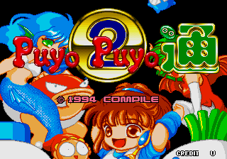
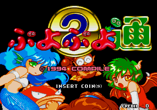
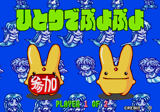
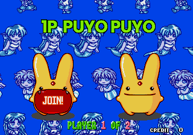
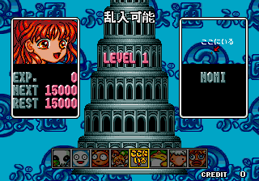
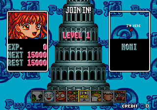
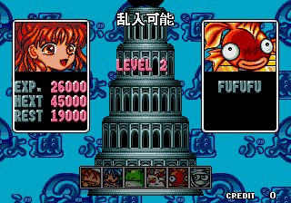
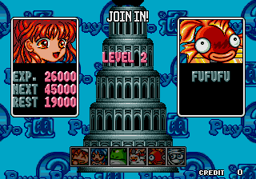
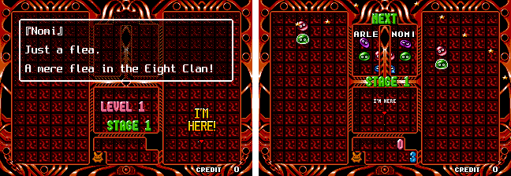

# Puyo Puyo 2 English (Sega C2 arcade)

An English translation of the arcade *Puyo Puyo 2* (ぷよぷよ通, Compile 1994, Sega C2
board, MAME set `puyopuy2`), as a bootleg clone set `puyopuy2e` for
[mame2003-plus](https://github.com/zanac/mame2003-plus-libretro) (branch `puyopuy2e`).

Everything Japanese on screen is translated: the character profiles before each match,
the attract mode's tutorial pages, the title logo, the entry screen, the tower, the rule
and level select screens, the join-in messages, the continue and win screens and the
service menu. The character names follow the English names of the Super Puyo Puyo 2 fan
translation by J2e Translations (Skeleton-T, Mini Zombie, Sukiyapodes, ...).




*`puyopuy2e`: the title (MAME) and a tutorial page (mame2003-plus core).*

## For dummies

You need one file you already have from your MAME/RetroArch ROM collection:
`puyopuy2.zip` (Puyo Puyo 2, the MAME set). This project does not give it to you.

1. Install Python 3 (Windows: [python.org](https://www.python.org/downloads/), tick
   "Add python.exe to PATH" during the setup; macOS and Linux usually have it already).
   Nothing else is needed.
2. Download this project: green **Code** button on GitHub, **Download ZIP**, and unpack
   it. Or with git:
   ```
   git clone https://github.com/zanac/puyopuy2e
   ```
3. Put `puyopuy2.zip` in the `puyopuy2e` folder you just unpacked (next to this README).
4. Open a terminal in that folder (Windows: type `cmd` in the address bar of the folder
   window and press Enter) and run:
   ```
   python3 make_puyopuy2e.py
   ```
   On Windows, if `python3` is not found, use `python` or `py` instead:
   ```
   py make_puyopuy2e.py
   ```
5. You get `puyopuy2e.zip` in the same folder, the full English ROM set (all three chips,
   it does not need `puyopuy2.zip` any more). The script prints "written ...
   puyopuy2e.zip", the CRC of every file and "CRCs match expected (...)".
6. Copy `puyopuy2e.zip` into your ROM folder and start it with the **mame2003-plus**
   core (RetroArch: Load Content, pick `puyopuy2e.zip`, choose "Arcade (MAME
   2003-Plus)"). The core must be a build with the `puyopuy2e` entry (branch
   `puyopuy2e` of [zanac/mame2003-plus-libretro](https://github.com/zanac/mame2003-plus-libretro)).

The zip can also be somewhere else: `python3 make_puyopuy2e.py FOLDER [OUT_FOLDER]`, or
the path of the zip itself. You can pick the title logo with `--logo`:
`no-red-puyos` (default: "Puyo Puyo 通", red puyos removed), `with-red-puyos`
("Puyo Puyo 通" with red puyos over the `u` letters), or `original` (Japanese `ぷよぷよ通`
untouched). If the script says a chip is not found, your `puyopuy2.zip`
is a different dump: check it against the input table below (the chips are found by CRC,
the names inside the zip do not matter).

## Support
Hey dude! Help me out for a couple of :beers: or a :coffee:!<br/>
[](https://bmc.link/zanac)

## Status

| Part | State |
|---|---|
| Character profiles before each match: 33 characters, 58 pages | English, new 8x16 text engine and font (all pages below) |
| Attract mode tutorial pages (15) and their titles | English |
| JOINING IN tutorial page (linked cabinets only): 乱入するの？ / はい / いいえ | JOIN IN? / YES / NO |
| Title logo ぷよぷよ通 | redrawn as "Puyo Puyo 通" (`--logo`: `no-red-puyos` default, `with-red-puyos`, or `original`) |
| Entry screen: 参加者募集中, 参加, ひとりでぷよぷよ ... | PLAYERS WANTED!, JOIN!, 1P/2P PUYO PUYO (centred) |
| Entry screen: 2Pのスタートボタンを押してね over the rabbit still waiting | PUSH 2P START! (and 1P) |
| Tower: 相手をえらんでね, ここにいる (Nomi) | PICK YOUR RIVAL, I'M HERE (plus Nomi's blown-up I'M HERE! / YAY! / K.O. sprites) |
| 乱入可能 sign, 連鎖 counter, 全消し | JOIN IN!, CHAIN, ALL CLEAR |
| 相殺 in a four-player (linked) match | OFFSET |
| ばたんきゅ～ over a knocked-out player's field, big and in the small fields of the score panel | K.O. |
| Rule select screen | CHOOSE A RULE! and both rule lines |
| Level select: 激甘 ... 激辛 | EXTRA MILD, MILD, MEDIUM, HOT, EXTRA HOT |
| Join-in and link messages, はい / いいえ | NEW CHALLENGER!, YES / NO (also when highlighted), ...; centred on screen |
| Continue screen, win screen (やった) | CONTINUE?, YAY! |
| Act Against AIDS slogan 勇気と愛気 | COURAGE AND LOVE |
| Service menu romaji, ending record (MAX RENSA) | English |
| ROM set `puyopuy2e`, driver entry | done; checked in MAME 0.264 and in the mame2003-plus core |
| Full game, start to ending, 1 player and 2 players | played in MAME: every screen in English |
| Two linked cabinets, 3 and 4 players | entry, join prompts, match and results checked with an emulated link (see below) |

Known limits:

- The ending is the same at every Difficulty setting (played to the end at Easy, Medium
  and Hardest in MAME: same frames) and has no text; its playing record keeps the game's own romaji names of the
  rivals (SUKETOUDARA, SHEZO WEGEY, ...), already in Latin letters.
- The link between two cabinets (the PUYO2Z80 communication board at `0x880100`) is not
  emulated by MAME or mame2003-plus. The four-player screens were checked with two
  instances of the core joined by a high-level stand-in for the board (a local test
  harness, not part of the driver): entry screen, join prompts, four-player match,
  results and the attract pages shown only when linked. Thanks to thomasbender for the
  four-player screenshots that showed what was left, and for the logo variants (with 通 kept
  within the sprite budget) and the MEMORY TEST checksums (PR #2).
- The 3P PUYO PUYO line of a linked game sits a few pixels right of centre: its number
  block is wider and the PUYO PUYO block is shared by all four.

## Screenshots

Japanese arcade original on the left, `puyopuy2e` on the right (MAME; the linked-cabinet ones from two mame2003-plus instances joined by the test link, see Known limits).

| | Original | English |
|---|---|---|
| Title |  |  |
| Act Against AIDS |  |  |
| Tutorial |  |  |
| Tutorial |  |  |
| Entry |  |  |
| Entry, game mode |  |  |
| Tower |  |  |
| Tower |  |  |
| Profile |  |  |
| Join-in |  |  |
| Linked cabinets: join prompt |  |  |
| Linked cabinets: knocked out |  |  |
| Linked cabinets: tutorial |  |  |
| Rule select |  |  |
| Level select |  |  |
| Win |  |  |
| Continue |  |  |

Every English text page, drawn from the built ROM with its own font and layout
(`tools/text_sheet.py`): the profiles of the 33 characters (a character's second page
follows its first) and the tutorial pages, the TURN DIRECTION variant of the controls
page among them.


## The fighters

Every rival in the game, as `puyopuy2e` shows them (MAME): the profile pages before the
match, each one when its text is complete, and the match that follows. The game picks
the rival from the tower; for these pictures the rival was forced through the game's own
debug variable (`0xff4810`, see the [notes](docs/notes.md)), so all of them were taken on
the first floor (LEVEL 1, STAGE 1), with the rival's own stage.

| Fighter | Profile and match |
|---|---|
| Will-o'-Wisp |  |
| Momomo |  |
| Nohoho |  |
| Nomi |  |
| Skeleton-T |  |
| Mini Zombie |  |
| Nasu Grave |  |
| Sukiyapodes |  |
| Samurai Mole |  |
| Mummy |  |
| Owlbear |  |
| Barometz |  |
| Banshee Trio |  |
| Fufufu |  |
| Cait Sith Twins |  |
| Zombie |  |
| Panotty |  |
| Sasoriman |  |
| Suketoudara |  |
| Uroko Sakanabito |  |
| Harpy |  |
| Parara |  |
| Dragon |  |
| Witch |  |
| Pakista |  |
| Draco Centaur |  |
| Rulue |  |
| Minotauros |  |
| Zoh Daimaoh |  |
| Mamono |  |
| Shezo Wegey |  |
| Satan |  |
| Masked Satan |  |

## The ROM set

Input, the chips of `puyopuy2.zip`:

| File | Size | CRC32 | SHA1 |
|---|---|---|---|
| epr-17241.ic32 | 524288 | 1cad1149 | 77fb0482fa35e615c0bed65f4d7f4dd89b241f23 |
| epr-17240.ic31 | 524288 | beecf96d | c2bdad4b6184c11f81f2a5db409cb4ea186205a7 |
| epr-17239.ic4 | 524288 | 020ff6ef | 6095b8277b47a6fd7a9721f15a70ae5bf6be9b1a |

Output, the files of `puyopuy2e.zip` (by `--logo` mode):

| `--logo` | File | Size | CRC32 | SHA1 | From |
|---|---|---|---|---|---|
| `no-red-puyos` (default) | pp2e-17241.ic32 | 524288 | 30aa4d00 | c5bd269591ce93e900131e439a744fd0f14bb263 | epr-17241.ic32, changed |
| `no-red-puyos` (default) | pp2e-17240.ic31 | 524288 | 9df07ff6 | 322029b9f355135bf7d0080b2d9f89a7f259e6c8 | epr-17240.ic31, changed |
| `with-red-puyos` | pp2e-17241.ic32 | 524288 | fd4fbd02 | a159f3c00406fb4f584ec78110f35d6b3e415314 | epr-17241.ic32, changed |
| `with-red-puyos` | pp2e-17240.ic31 | 524288 | 9931ce5b | e8b852b99eb333ecfae3ebfbc0f8b95cdba1c235 | epr-17240.ic31, changed |
| `original` | pp2e-17241.ic32 | 524288 | 3a6607d1 | 1ed6b81ab2c480c3281d01ede7a7f67f539ed358 | epr-17241.ic32, changed |
| `original` | pp2e-17240.ic31 | 524288 | c375d2c5 | 87a6454ec52c6f57413203a53095e762cf36ae67 | epr-17240.ic31, changed |
| all | epr-17239.ic4 | 524288 | 020ff6ef | 6095b8277b47a6fd7a9721f15a70ae5bf6be9b1a | copied |

The two 16-bit EPROM checksums at `0x1f8`/`0x1fa` are recalculated for each build so the
cabinet `TEST SYSTEM -> MEMORY TEST` passes (`GOOD`). The `puyopuy2e` entry of
mame2003-plus expects the default (`no-red-puyos`) CRCs; the other two variants run there
only if the core does not check them. To try any variant in a recent MAME
instead, put the two `pp2e` files in a copy of `puyopuy2.zip` under the names
`epr-17241.ic32` and `epr-17240.ic31` and start `puyopuy2`.

## How it is built

`make_puyopuy2e.py` reads the program of `puyopuy2.zip` and runs `tools/build.py`, which
redoes the whole translation from the original program every time; the result is the
same byte for byte. The English text is `text/script_en.py`; the PNGs in `assets/gfx`
are the big lettering. Only the Python 3 standard library is used.

| File | Purpose |
|---|---|
| `make_puyopuy2e.py` | the ROM set from `puyopuy2.zip` |
| `tools/build.py` | the whole build, step by step |
| `text/script_en.py` | the English profiles and tutorial pages |
| `tools/text.py` | writes the pages and points the original ones at them |
| `patch/text8.s`, `patch/hooks.s` | the new text engine (8x16 glyphs) and the page hooks (68000; `patch/assemble.sh` rebuilds the `.bin`) |
| `tools/font.py`, `font/spleen-8x16.bdf` | the text font |
| `font/title_font.py` | the capitals of the tutorial titles and small labels |
| `tools/titles.py` | the tutorial page titles |
| `tools/labels.py` | the other screens' graphics and the service menu words |
| `tools/logo.py` | the title logo |
| `tools/linkmsg.py` | the join-in and link messages |
| `tools/levels.py` | the level select labels |
| `tools/gfx.py` | tiles, maps, the compressed graphics streams and where they go |
| `tools/lz.py` | the game's LZ format, unpacker and packer |
| `tools/text_sheet.py` | draws every English page from a built `puyopuy2e.zip` (the sheet above) |
| `tools/png.py` | reads and writes the PNGs |
| `tools/romset.py` | the chips of the MAME set |
| `tools/make_gfx_assets.py`, `tools/bigtext.py` | draw `assets/gfx` (maintainers only: Pillow and the Poppins Bold font) |

Technical notes on the game: [docs/notes.md](docs/notes.md).

## Credits and license

- Translation and hacking: Zanac (Vanni Brutto).
- Character names: from the Super Puyo Puyo 2 English translation by J2e Translations.
- Text font: [Spleen](https://github.com/fcambus/spleen) 8x16 by Frederic Cambus, BSD
  2-clause license (`font/LICENSE-spleen`).
- Title logo: the "Puyo Puyo" lettering is cut from `assets/puyopuyo_logo.jpg`
  (`logo_puyo.png`, in the colours of the original logo).
- Big lettering of `assets/gfx`: drawn with Poppins Bold (SIL Open Font License) by the
  maintainer script; the font itself is not part of the project.
- *Puyo Puyo 2* © Compile 1994, Sega. This project distributes no game data: the build
  starts from your own `puyopuy2.zip`.
